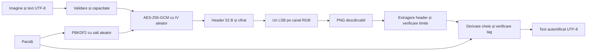

# Analiza propunerii Criptarea mesajelor în imagini

Propunerea echipei Meriacre Victor, Parfeni Inga și Rudinciuc Victor, SI-252,
definește o aplicație full-stack care combină criptografia autentificată cu
steganografia și cere explicit analiză de corectitudine, complexitate, eficiență și
securitate. Documentul are o pagină și include problema, tema, scopul și 14 obiective.
Implementarea concretizează aceste obiective într-un produs local verificabil.
Fișierul original este păstrat nemodificat.

## Evaluarea problemei și a scopului

Problema este bine motivată: interceptarea unui mesaj poate compromite conținutul,
iar un cifrat vizibil poate dezvălui existența unei comunicări protejate. AES-GCM
asigură confidențialitate și integritate pentru mesaj; LSB transportă cifratul în pixeli.
Cele două proprietăți sunt distincte. Ascunderea vizuală nu demonstrează
nedetectabilitate statistică, iar criptarea nu ascunde metadatele comunicației.

Scopul este realizabil într-un proiect universitar, dar termenul „securitate” trebuie
evaluat printr-un model de amenințări explicit. Acest produs presupune un server de
încredere, o parolă suficient de puternică și transmiterea fișierului fără schimbarea
pixelilor. Compromiterea serverului sau a terminalului utilizatorului depășește
protecția oferită de pachetul criptografic.

În propunere nu sunt fixate valorile saltului/IV-ului/tag-ului, numărul de iterații,
formatul binar, ordinea biților, limitele fișierelor, modelul de încredere, codarea
textului sau criteriile de acceptare. Cererea de implementare și profilul documentat
le stabilesc fără a schimba algoritmii aleși. Detaliul „caractere disponibile” este
înlocuit în calcule cu octeți UTF-8, cu estimări explicite pentru ASCII și 4 octeți.

## Trasabilitatea celor 14 obiective

| Nr. | Obiectiv din propunere | Concretizare și dovadă |
|---:|---|---|
| 1 | Cercetarea criptografiei și steganografiei | model de amenințări, protocol și bibliografie primară |
| 2 | Analiza soluțiilor existente | comparația de mai jos cu OpenStego și steghide |
| 3 | Cerințe funcționale/nefuncționale | criteriile de acceptare și API documentat |
| 4 | AES-256-GCM | `crypto_engine.py`, tag complet, teste de alterare |
| 5 | PBKDF2-HMAC-SHA-256 | cheie 32 B, salt 16 B, 600.000 iterații, vector independent |
| 6 | LSB pentru integrare/extragere | `stego_engine.py`, ordine exactă, alfa păstrat |
| 7 | Concepție și flux | pașii de procesare de mai jos |
| 8 | Arhitectură full-stack | interfață fără build, FastAPI, module independente |
| 9 | Modelare algoritmică | protocol, formule și complexități |
| 10 | Implementare și integrare | patru endpoint-uri reale, interfață conectată |
| 11 | Interfață încărcare/mesaje/rezultate | drag & drop, preview, indicator UTF-8, descărcare |
| 12 | Teste pe dimensiuni diferite | teste de limită și benchmark parametrizat |
| 13 | Timp, memorie și impact | `benchmark.py`, PSNR, SSIM, histogramă, χ² |
| 14 | Documentare, concluzii și îmbunătățiri | README, API, protocol, securitate, verificare și direcțiile de evoluție de mai jos |

## Soluții existente

| Soluție | Funcții documentate | Relația cu proiectul |
|---|---|---|
| OpenStego | ascundere/extragere, plugin RandomLSB, criptare AES opțională | exemplu practic de combinare; formatul său nu este compatibil cu STEG |
| steghide | imagini/audio, abordare bazată pe grafuri, compresie și criptare | arată că integrarea poate reduce schimbările distribuțiilor prin metode diferite de LSB secvențial |
| StegVault | AES-GCM obligatoriu, profil binar fix, un LSB/RGB, API web și metrici | prioritizează claritatea algoritmică, integritatea și măsurarea reproductibilă |

Comparația se bazează pe [documentația OpenStego](https://www.openstego.com/cmdline.html)
și [manualul steghide](https://steghide.sourceforge.net/documentation/manual.pdf).
Nu au fost executate benchmark-uri comparative cu aceste produse și nu se afirmă
superioritate în securitate sau performanță. Algoritmii și formatele diferă.

## Cerințe și criterii de acceptare

| Cerință | Criteriu verificabil |
|---|---|
| Încărcare sigură | doar PNG/BMP decodabile, maximum 10 MiB și 12 MP; APNG și 16-bit respinse |
| Confidențialitate | AES-256-GCM din bibliotecă menținută; cheia/parola nu apar în pachet |
| Integritate | orice bit schimbat în cifrat/tag determină respingere înainte de returnarea textului |
| Aleatorizare | criptări repetate generează salt și IV noi |
| Capacitate | mesajul se măsoară în octeți UTF-8; overflow respins fără trunchiere |
| Fidelitate | un canal folosit se modifică cu maximum 1; alfa și canalele nefolosite sunt identice |
| Recuperare | mesajul UTF-8 este identic după salvare PNG și reîncărcare |
| Erori controlate | lipsa mesajului, parola greșită, fișierele invalide și limitele au răspuns structurat |
| Interfață | două tab-uri, utilizabilă cu tastatura și pe ecrane mici, stare de procesare vizibilă |
| Confidențialitate operațională | fără persistență automată, fără logarea mesajelor/parolelor, răspunsuri no-store |
| Evaluare | PSNR/SSIM corecte numeric, histogramă și χ² cu limite explicite |

## Arhitectură și flux

Frontend-ul verifică pentru feedback rapid; backend-ul repetă validările, fiind
singura limită de încredere pentru datele trimise de client. Criptarea, decodarea și
metricile rulează în thread pool pentru a nu bloca event loop-ul. Middleware-ul
limitează numărul de procesări înainte de parsarea formularului. Datele rămân
în memoria cererii; se emit doar rezultatul PNG sau JSON-ul solicitat.

## Analiza complexității

Notăm P=WH pixeli, N=octeți ai mesajului și I=iterații PBKDF2. Cheia are 32 de
octeți, deci PBKDF2-HMAC-SHA-256 generează un singur bloc de ieșire.

| Operație | Timp | Memorie suplimentară în implementare |
|---|---|---|
| Capacitate după decodare | O(1) | O(1) |
| Decodare/normalizare | O(P) în modelul pixelilor, dependentă și de compresie | O(P) |
| PBKDF2 | O(I), plus procesarea inițială a parolei limitate | O(1) față de N și P |
| AES-GCM | O(N) | O(N), rezultat și buffer autentificat |
| Header și serializare | O(N) | O(N) |
| Inserare LSB | O(P+N), deoarece tablourile sunt copiate | O(P+N) |
| Extragere LSB | O(P+N), prin materializarea RGB | O(P+N) |
| PSNR, histogramă și χ² | O(P+256) | O(P) pentru diferențe; O(256) histogramă/canal |
| SSIM | O(P·k²) ca limită conservatoare pentru k≤7 fix | O(P) cu constante semnificative |

Modelul SSIM folosește filtre optimizate în bibliotecă; k este limitat, deci costul
efectiv crește aproximativ liniar cu numărul de pixeli. Nu confundăm complexitatea
teoretică cu milisecundele măsurate. PNG poate domina timpul de serializare, iar
`benchmark.py` separă etapele și înregistrează condițiile execuției.

Pentru pixelii RGB pe 8 biți:
`MSE = sum((original-stego)^2)/(3WH)` și `PSNR = 10 log10(255²/MSE)`.
Dacă MSE=0, PSNR este infinit. SSIM compară luminanța, contrastul și structura
pe ferestre locale; se folosește `data_range=255`, canale RGB și fereastră adaptată.
Nu se scad tablouri uint8 direct, deoarece ar apărea overflow.

χ² pe perechi de niveluri evaluează `sum((n_even-n_odd)^2/(n_even+n_odd))`,
ignorând perechile goale. Sub ipoteza condiționată de probabilități egale în fiecare
pereche, fiecare pereche ocupată contribuie un grad de libertate. Efectivele mici
slăbesc aproximația; statisticile naturale și integrarea într-un prefix împiedică
interpretarea acestui test ca detector calibrat.

## Limite și îmbunătățiri

Magic-ul public și ordinea secvențială fac existența unui pachet STEG ușor de
recunoscut de cineva care cunoaște protocolul. Saltul și IV-ul nu trebuie ascunse
pentru securitatea AES, dar header-ul nu oferă negabilitate. PSNR și SSIM ridicate
arată fidelitate vizuală, fără să demonstreze rezistență la steganaliză.

Recompresia lossy, modificarea culorilor, redimensionarea sau decuparea pot distruge
mesajul. Nu există cod de corectare a erorilor. Header-ul nu permite migrarea
transparentă a KDF-ului. O parolă slabă poate fi ghicită offline, indiferent de limitele API.

Direcții separate pentru o versiune viitoare: protocol versionat cu parametri KDF,
criptare în browser pentru eliminarea încrederii în server, evaluare pe un corpus
public de fotografii cu seturi distincte de test, integrare adaptivă/permutată și
coduri de corectare a erorilor. Aceste schimbări trebuie evaluate și nu sunt prezentate
ca funcții implementate ale versiunii curente.

Bibliografie suplimentară: [OWASP Cryptographic Storage](https://cheatsheetseries.owasp.org/cheatsheets/Cryptographic_Storage_Cheat_Sheet.html),
[OWASP PBKDF2](https://cheatsheetseries.owasp.org/cheatsheets/Password_Storage_Cheat_Sheet.html),
[Pillow Image](https://pillow.readthedocs.io/en/stable/reference/Image.html),
[scikit-image SSIM/PSNR](https://scikit-image.org/docs/stable/api/skimage.metrics.html).
